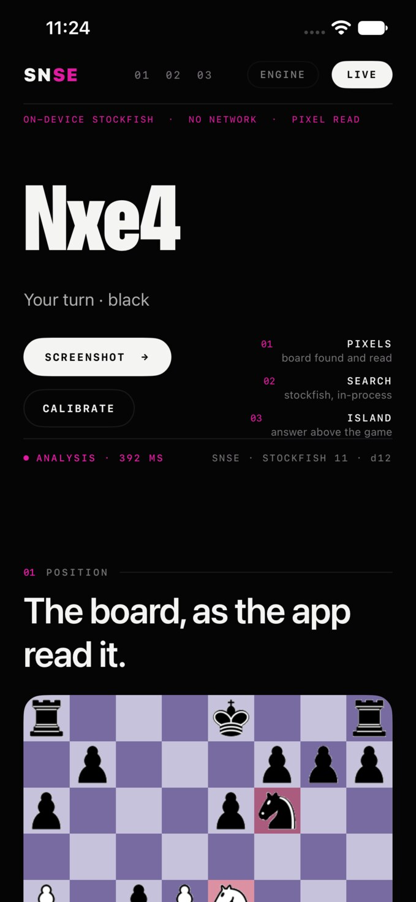
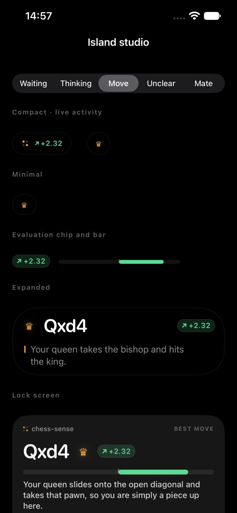

# SNSE — the best move, above the board

**Reads a chess board straight off the screen and puts Stockfish's best move in the Dynamic Island.
No servers, no accounts, no cloud engine — the search runs on the phone.**

[**How it works**](#how-it-works) · [**What works**](#what-works) · [**Limits**](#limits) · [**Credits**](#credits)

> [!NOTE]
> snse is a companion for the **TakeTakeTake** chess app on iOS. It is not affiliated with
> TakeTakeTake, chess.com or lichess. You supply your own board and your own game.

> [!IMPORTANT]
> **Everything happens on the phone.** The board is read from pixels, the move is searched on-device,
> and nothing is uploaded. The only optional network call is a language model you explicitly key in, and
> the app works fully without it.

## What this is

You screenshot the board. Half a second later the Dynamic Island is showing the move — in large
notation, with how you stand, and one sentence in plain English explaining *why*, with no chess
notation in it.

It is not a cloud service wearing an app's clothes. The reader is a small, self-checking vision
pipeline; the engine is Stockfish compiled into the app; the surface is a Live Activity, so the move
stays visible while you are looking at the game rather than the app.

## What works

| | Status |
|---|---|
| Read a board from a screenshot | Verified on real games, ~30 positions |
| Learn a new board theme from one frame | Self-verifying: a bad calibration is refused |
| Move generation, legality, SAN | Anchored against perft (start, Kiwipete, P3) |
| Stockfish 11, on-device, no network | ~100 ms at depth 12 in the middlegame |
| Best move in the Live Activity | Move, evaluation, plain-English reason |
| Plain-English coaching, no notation | On-device, plus optional model-written wording |
| Handles a board drawn from Black's side | Orientation read from the board's own labels |
| Silence when the read is uncertain | A refused read beats a confident wrong move |
| Answer time, shutter to Island | About half a second, mostly the pixel read |

## How to use it

1. **Calibrate once.** Start a fresh game, screenshot the starting position, pick it in the app.
   One frame teaches it every piece; the app then reads the position back and checks its own work.
2. **Play.** Screenshot whenever you want a move. Wire it to **Back Tap** or the **Action Button**
   through Shortcuts and it becomes a single tap on the back of the phone.
3. **Look at the Island.** The move, your standing, and the reason. Long-press to expand.

## How it works

Three stages, each of which can say "no":

- **Read.** The board is found as a rectangular region, the two square colours are estimated as a
  palette, and every square becomes a small descriptor. Pieces are identified against templates
  learned from your own board, so a theme it has never seen is a calibration, not a code change.
- **Track.** A single frame cannot know whose turn it is, what castling rights remain, or whether a
  pawn was just captured en passant. Move history supplies all of it: the observation is matched
  against the legal moves of the position the app already knows.
- **Search.** Stockfish runs in-process, so the answer never waits on a network. Its UCI loop is
  driven over an internal pipe — iOS does not allow spawning helper processes.

Anything ambiguous is surfaced as an explicit refusal rather than a guess, which is the single most
important property for a tool people will trust during a game.

## Limits

- **One board app, one theme at a time.** The recogniser is general — templates are learned, not
  hard-coded — but the board *finder* currently expects TakeTakeTake's layout. Other apps need a
  per-theme calibration and, for now, a known board rectangle.
- **Screenshots flash.** iOS has no silent screenshot API. The shutter animation belongs to
  SpringBoard, not to apps.
- **Free-team builds expire every 7 days.** A personal team's provisioning profile has to be
  re-signed; a paid developer account removes the expiry.
- **This is a study aid.** Using it in a rated online game is cheating, and it is built knowing that.

## Credits

- **Stockfish** — GPLv3, classical evaluation, compiled for arm64 and linked into the app.
- **Chess pieces** — Colin M.L. Burnett's set, CC BY-SA 3.0, the same set lichess and Wikipedia use.
- **Type** — Instrument Serif and Playfair Display, both SIL Open Font License 1.1.

## Licence

Source is provided as-is for study. Stockfish's GPLv3 applies to the engine and, by linking, to this
application.

